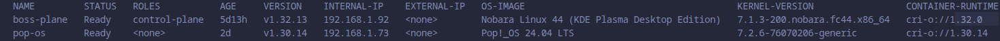
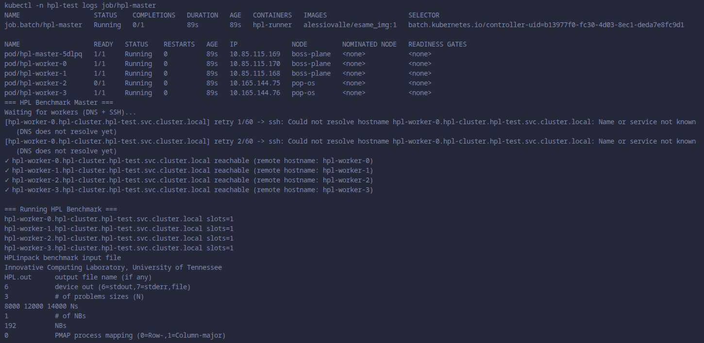
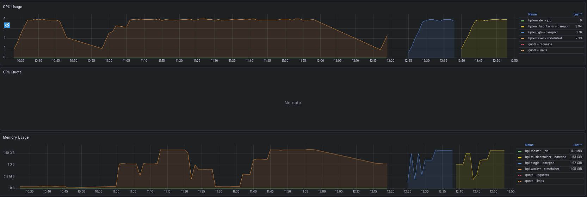
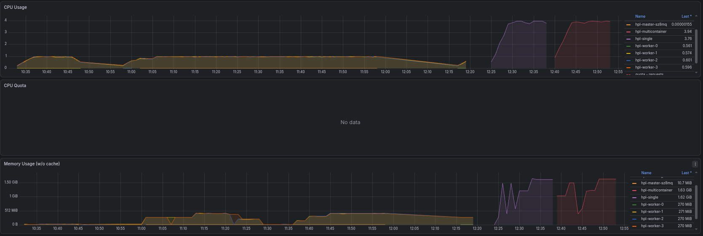
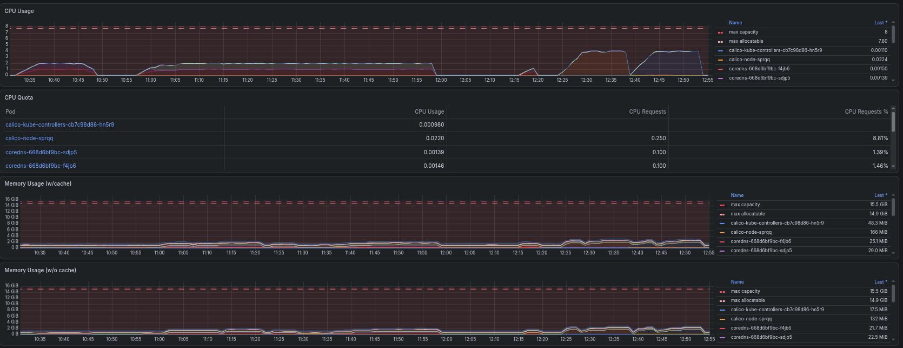
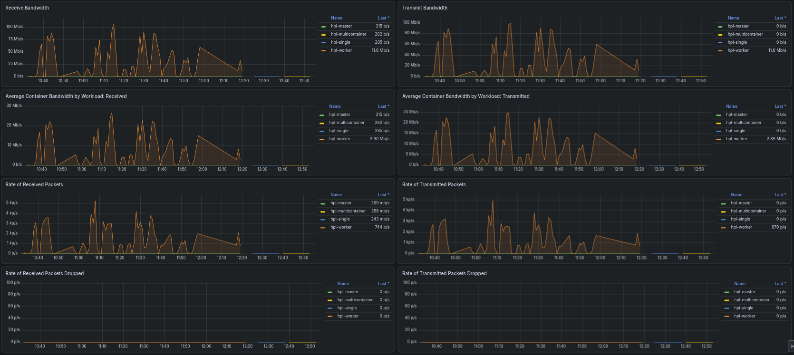
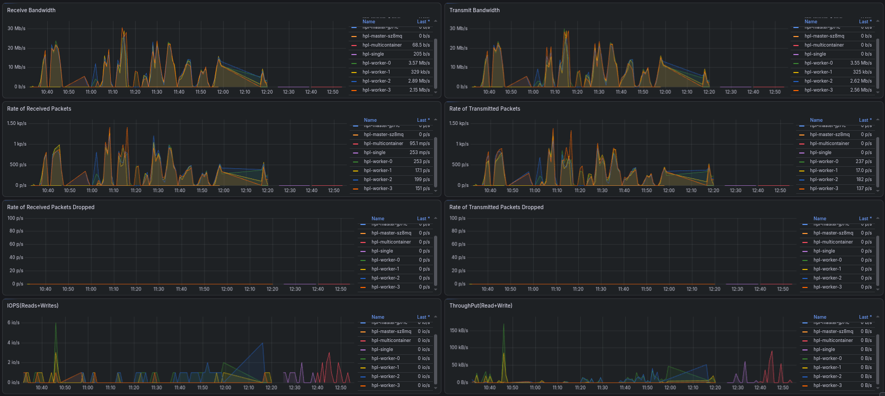
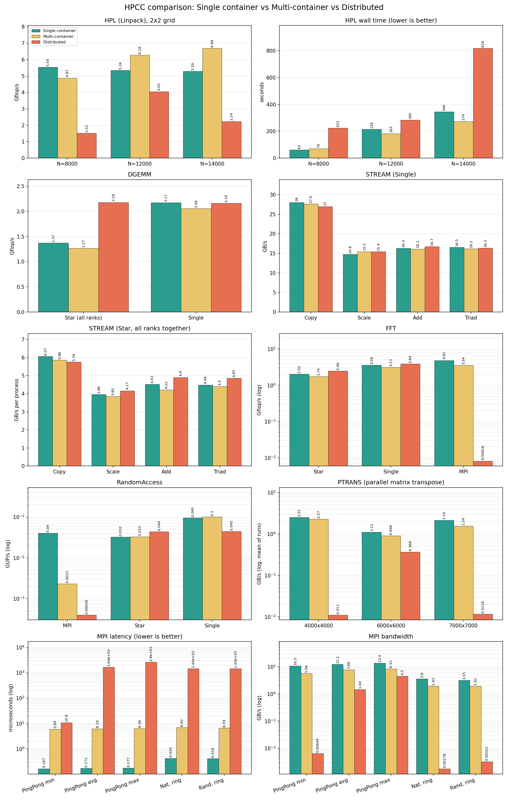

# EX1 Report: Network Performance of Linux Network Namespaces vs. a VM Baseline

## 1. Objective and test environment

For this report we follow the instructions given by the exam's ex1, which asks for a comparison of three ways to connect two Linux network namespaces, and for a comparison of those results with the basic cloud case. 

The namespaces ns1 and ns2 are plain Linux network namespaces created with `ip netns add`; no Docker is involved in the namespace tests. All namespace measurements were produced by the script `ex1_netns.sh` (section 2), which was executed three times: twice with a 10-second TCP test per topology (run 1 and run 2, which also produced the latency, UDP and tunnel-counter results), and once with five 60-second TCP runs per topology (the 60-second series, which gives the main throughput figures). Each execution rebuilt every topology from scratch. In every namespace test, the iperf3 server ran in ns2 and the client in ns1, on the default port 5201.

| Test | Path | Protocol | Duration |
| --- | --- | --- | --- |
| Direct veth, TCP | ns1 (10.0.0.1) to ns2 (10.0.0.2) | TCP, 1 stream | 60 s, 5 runs (earlier executions: 10 s, 2 runs) |
| Bridge, TCP | ns1 (192.168.10.1) to ns2 (192.168.10.2) | TCP, 1 stream | 60 s, 5 runs (earlier executions: 10 s, 2 runs) |
| Bridge + VXLAN, TCP | ns1 (192.168.60.1) to ns2 (192.168.60.2) | TCP, 1 stream | 60 s, 5 runs (earlier executions: 10 s, 2 runs) |
| Namespaces, UDP (all three) | same paths as above | UDP, 100 Mbit/s target | 60 s |
| Namespaces, latency (all three) | same paths as above | ICMP echo, 100 packets at 0.2 s intervals | about 20 s |
| VM, TCP | nodo1 (192.168.56.128) to master (192.168.56.1), port 5202 | TCP, 1 stream | 60 s |
| VM, UDP | nodo1 to master, port 5202 | UDP, 100 Mbit/s target | 60 s |
| Docker, TCP (nodo1) | nodo1 (172.20.0.4) to master (172.20.0.10), port 5202 | TCP, 1 stream | 60 s |
| Docker, TCP (nodo2) | nodo2 (172.20.0.3) to master (172.20.0.10), port 5202 | TCP, 1 stream | 60 s |
| Docker, UDP (nodo1) | nodo1 to master, port 5202 | UDP, 100 Mbit/s target | 60 s |
| Docker, UDP (nodo2) | nodo2 to master, port 5202 | UDP, 100 Mbit/s target | 60 s |

## 2. Setup

### The test script

`ex1_netns.sh` builds, tests and removes the three topologies one after the other, so only one topology exists at any time and each one starts from freshly created namespaces. For every topology it does the following:

1. Removes any leftovers from a previous run, creates `ns1` and `ns2` with `ip netns add` and brings `lo` up in both.
2. Builds the topology (below) and sends 3 pings from ns1 to ns2; if they fail, the topology is skipped.
3. Starts the iperf3 server in ns2 as a daemon.
4. Runs 100 pings at 0.2 s intervals from ns1 (`<topology>_ping.txt`).
5. Runs the TCP test (`<topology>_tcp_run1.txt`): 10 s by default and one run, set by the `DUR` and `RUNS` variables.
6. Runs the UDP test at 100 Mbit/s for 60 s (`<topology>_udp.txt`).
7. For VXLAN only, saves the counters of `vxlan1` (`vxlan_counters.txt`).
8. Stops the server and removes everything it created.

I also used an earlier manual procedure that obtained the two empty namespaces from two idle containers started with `--network none`. That only supplied the namespaces and has no effect on the network path being measured; the script replaces it with plain `ip netns add` namespaces. This was taken from a tutorial I found online, but it was useless.

### Namespaces

```sh
sudo ip netns add ns1
sudo ip netns add ns2
ip netns list   # ns1, ns2
```

### Topology A: direct veth pair

One veth pair is created with each end already inside a namespace. The ends start DOWN, so each gets an address and is brought up together with `lo`.

```sh
sudo ip link add veth0 netns ns1 type veth peer name veth1 netns ns2
sudo ip netns exec ns1 ip addr add 10.0.0.1/24 dev veth0
sudo ip netns exec ns1 ip link set veth0 up
sudo ip netns exec ns1 ip link set lo up
sudo ip netns exec ns2 ip addr add 10.0.0.2/24 dev veth1
sudo ip netns exec ns2 ip link set veth1 up
sudo ip netns exec ns2 ip link set lo up
```

### Topology B: two veth pairs and one bridge

Each namespace gets its own veth pair. The host-side end of each pair is attached to the bridge `v-net-0`.

```sh
sudo ip link add v-net-0 type bridge && sudo ip link set dev v-net-0 up
sudo ip link add b-veth0 type veth peer name b-veth0-br
sudo ip link add b-veth1 type veth peer name b-veth1-br
sudo ip link set b-veth0 netns ns1 && sudo ip link set b-veth0-br master v-net-0
sudo ip link set b-veth1 netns ns2 && sudo ip link set b-veth1-br master v-net-0
sudo ip netns exec ns1 ip addr add 192.168.10.1/24 dev b-veth0
sudo ip netns exec ns2 ip addr add 192.168.10.2/24 dev b-veth1
sudo ip netns exec ns1 ip link set b-veth0 up
sudo ip netns exec ns2 ip link set b-veth1 up
sudo ip link set b-veth0-br up && sudo ip link set b-veth1-br up
```

### Topology C: two bridges joined by VXLAN

Each namespace is attached to its own bridge (`vx-net-0` in the root namespace, `vx-net-1` in a third namespace, `host2`). A VXLAN interface on each bridge carries the traffic between them, over an underlay veth pair (`vx-under0`, `vx-under1`) that connects the root namespace and `host2`. Putting the second bridge in its own namespace makes the underlay a real routed link between two "hosts", so a frame can only get from ns1 to ns2 by being encapsulated.

```
 ns1                root namespace                         host2 namespace                  ns2
vx-veth0 ── vx-veth0-br ── [vx-net-0] ── vxlan1 ═ vx-under0 ──── vx-under1 ═ vxlan2 ── [vx-net-1] ── vx-veth1-br ── vx-veth1
                                          VNI 100, UDP 4789, 10.10.10.1 <-> 10.10.10.2, underlay MTU 1600
```

The underlay MTU is 1600 so that the 50 bytes of VXLAN overhead (outer IP, UDP, VXLAN and inner Ethernet headers) do not reduce the MTU seen by ns1 and ns2, which stays at 1500 as in topologies A and B.

```sh
sudo ip netns add host2
sudo ip netns exec host2 ip link set lo up

# underlay link between the root namespace and host2 (MTU 1600 leaves room for the 50-byte VXLAN header)
sudo ip link add vx-under0 type veth peer name vx-under1 netns host2
sudo ip link set vx-under0 mtu 1600
sudo ip netns exec host2 ip link set vx-under1 mtu 1600
sudo ip addr add 10.10.10.1/24 dev vx-under0
sudo ip netns exec host2 ip addr add 10.10.10.2/24 dev vx-under1
sudo ip link set vx-under0 up
sudo ip netns exec host2 ip link set vx-under1 up

# VXLAN endpoints: same VNI and same port on both sides
sudo ip link add vxlan1 type vxlan id 100 local 10.10.10.1 remote 10.10.10.2 dstport 4789 dev vx-under0
sudo ip netns exec host2 ip link add vxlan2 type vxlan id 100 local 10.10.10.2 remote 10.10.10.1 dstport 4789 dev vx-under1
sudo ip link set vxlan1 mtu 1500
sudo ip netns exec host2 ip link set vxlan2 mtu 1500

# one bridge per side, each holding its VXLAN interface
sudo ip link add vx-net-0 type bridge
sudo ip netns exec host2 ip link add vx-net-1 type bridge
sudo ip link set vxlan1 master vx-net-0
sudo ip netns exec host2 ip link set vxlan2 master vx-net-1

# veth pairs from ns1 and ns2 to their bridge, then the addresses
sudo ip link add vx-veth0 netns ns1 type veth peer name vx-veth0-br
sudo ip link add vx-veth1 netns ns2 type veth peer name vx-veth1-br netns host2
sudo ip link set vx-veth0-br master vx-net-0
sudo ip netns exec host2 ip link set vx-veth1-br master vx-net-1
sudo ip netns exec ns1 ip addr add 192.168.60.1/24 dev vx-veth0
sudo ip netns exec ns2 ip addr add 192.168.60.2/24 dev vx-veth1

# bring everything up
sudo ip link set vxlan1 up
sudo ip link set vx-veth0-br up
sudo ip link set vx-net-0 up
sudo ip netns exec host2 ip link set vxlan2 up
sudo ip netns exec host2 ip link set vx-veth1-br up
sudo ip netns exec host2 ip link set vx-net-1 up
sudo ip netns exec ns1 ip link set vx-veth0 up
sudo ip netns exec ns2 ip link set vx-veth1 up
```

### Connectivity

Connectivity was checked by the script with 3 pings before each test, and all three topologies passed in both runs. The 100-packet latency tests then had 0% loss in every topology.

## 3. Results: namespace topologies

The TCP throughput comes from a series of five 60-second runs per topology (section 3.1). Latency (3.2), UDP jitter (3.3) and the tunnel counters (3.4) come from the two earlier script executions (run 1 and run 2), whose TCP tests lasted 10 s. The order is the same in all of them: the direct veth pair is fastest, the bridge is a few percent behind, and the VXLAN topology reaches about 56% of the bridge throughput with more than twice the latency.

### 3.1 TCP throughput (five 60-second runs)

| Topology | Run 1 | Run 2 | Run 3 | Run 4 | Run 5 | Mean (Gbit/s) | Std. dev. | Change vs. veth |
| --- | --- | --- | --- | --- | --- | --- | --- | --- |
| A. Direct veth | 45.9 | 51.4 | 51.0 | 49.9 | 50.9 | 49.8 | 2.3 | baseline |
| B. Bridge | 46.8 | 47.4 | 48.0 | 47.9 | 47.9 | 47.6 | 0.5 | −4.5% |
| C. Bridge + VXLAN | 27.7 | 27.8 | 27.6 | 27.8 | 27.9 | 27.8 | 0.1 | −44.3% |

| Topology | Data per run (GB) | Per-second range (Gbit/s) | Retransmissions per run (total) | Final cwnd range |
| --- | --- | --- | --- | --- |
| A. Direct veth | 320, 359, 356, 348, 355 | 40.7–52.3 | 1, 0, 1, 1, 0 (3) | 2.12–5.77 MB |
| B. Bridge | 327, 331, 336, 335, 334 | 43.2–48.7 | 0, 0, 0, 0, 0 (0) | 2.21–5.32 MB |
| C. Bridge + VXLAN | 193, 194, 193, 194, 195 | 25.4–28.3 | 180, 319, 857, 73, 0 (1,429) | 2.46–5.90 MB |

**Ranking and size of the effects.** Relative to the veth pair, the bridge cost 4.5% and VXLAN 44.3%; relative to the bridge. The VXLAN result is extremely repeatable (27.6–27.9 Gbit/s in all five runs) and lies far outside the other two. The gap between veth and bridge is only 2.2 Gbit/s, about the standard deviation of the veth runs (2.3 Gbit/s). That spread comes mainly from the first veth run (45.9 Gbit/s), which was also the most irregular of all 15 runs (slowest second 40.7 Gbit/s, standard deviation between seconds 2.0 Gbit/s against 0.7–1.3 in the other four veth runs). Without it the veth mean is 50.8 Gbit/s and the bridge cost 6.3%, in line with the 6–9% of the two 10-second executions. The cost of the bridge is therefore somewhere between about 4% and 9%: its direction is reproduced everywhere, its size is the least certain figure in the report. The first bridge run (46.8 Gbit/s) was also the lowest of its series, which may point to a warm-up effect, but two cases are not enough to say.

**Retransmissions.** VXLAN had retransmissions in four of its five runs (73 to 857 per run, 1,429 in total, in bursts lasting one to four seconds), the veth pair had three single retransmissions in three runs, and the bridge had none. The rates arhttps://sqliteviewer.app/#/DB40.db/table/Masters/e negligible (under 0.001% of the segments, assuming about 1,448 bytes per segment) and did not affect throughput: the VXLAN run with none reached 27.9 Gbit/s and the others 27.6–27.8. Of the three topologies, the tunnel path is the only one with recurring but rare loss events.

**Congestion window.** The final window ranged from 2.1 to 5.9 MB in all three topologies without any relation to throughput: the fastest veth run (51.4 Gbit/s) ended at 2.12 MB and the slowest (45.9 Gbit/s) at 4.12 MB, and several runs went above 4 MB. The window was therefore not what limited TCP, and the plateau near 4 MB seen in the short runs was not a buffer ceiling. Throughput is most likely limited by per-packet CPU work, which is consistent with the flat 27.8 Gbit/s of VXLAN, but no CPU data was recorded to confirm this.

**Possible cause of the variation.** The differences between runs of the same topology, between the 10-second and 60-second tests, and between sessions are larger than the topologies themselves can explain. They are probably due to other work on the test machine, namely Kubernetes processes and internet traffic, competing for the same CPU and kernel network stack. This was not measured; section 6.5 explains how it fits the data and what it limits.

### 3.2 Latency

Each topology was tested with 100 pings at 0.2 s intervals in each run; none lost a packet.

| Topology | Run | Min (ms) | Avg (ms) | Max (ms) | Std. dev. (ms) |
| --- | --- | --- | --- | --- | --- |
| A. Direct veth | 1 | 0.018 | 0.031 | 0.056 | 0.007 |
| A. Direct veth | 2 | 0.014 | 0.036 | 0.221 | 0.023 |
| B. Bridge | 1 | 0.019 | 0.037 | 0.099 | 0.011 |
| B. Bridge | 2 | 0.023 | 0.040 | 0.190 | 0.021 |
| C. Bridge + VXLAN | 1 | 0.052 | 0.076 | 0.163 | 0.018 |
| C. Bridge + VXLAN | 2 | 0.052 | 0.093 | 0.496 | 0.047 |

The minimum is the most stable figure: it is exactly 0.052 ms for VXLAN in both runs, against 0.014–0.023 ms for the veth pair and the bridge, so the tunnel adds roughly 0.03–0.04 ms to the best-case round trip. The maxima (0.056–0.496 ms) and the standard deviations are larger in run 2 for every topology and are dominated by a few outliers, so the average and the minimum are the figures to rely on.

### 3.3 UDP at 100 Mbit/s

| Topology | Run | Datagrams sent | Lost | Receiver jitter (ms) |
| --- | --- | --- | --- | --- |
| A. Direct veth | 1 | 517,964 | 0 (0%) | 0.005 |
| A. Direct veth | 2 | 517,967 | 0 (0%) | 0.004 |
| B. Bridge | 1 | 517,960 | 0 (0%) | 0.004 |
| B. Bridge | 2 | 517,958 | 0 (0%) | 0.010 |
| C. Bridge + VXLAN | 1 | 517,964 | 0 (0%) | 0.020 |
| C. Bridge + VXLAN | 2 | 517,957 | 0 (0%) | 0.008 |

No topology lost a datagram in either run. At this level the differences are noise, so jitter is not used to rank the topologies. The 100 Mbit/s load is a fraction of what these paths carried over TCP, so this test shows timing quality, not capacity.

### 3.4 Evidence that the traffic used the tunnel

After the VXLAN tests of each run, the script saved the counters of `vxlan1`:

| Counter | Run 1 | Run 2 |
| --- | --- | --- |
| TX bytes | 26,875,942,981 (26.9 GB) | 33,500,089,727 (33.5 GB) |
| TX packets | 1,108,328 | 1,265,612 |
| RX bytes | 25,877,115 | 37,303,042 |
| RX packets | 497,503 | 717,278 |
| Errors and dropped (TX and RX) | 0 | 0 |

The tens of gigabytes on the TX side show that the traffic went through `vxlan1`. In both runs the figure matches the sum of what iperf3 reported for the TCP test and the UDP test (24.3 GBytes + 715 MBytes in run 1, 30.5 GBytes + 715 MBytes in run 2).

## 4. Comparison with the cloud basic cases (VM and Docker)

### 4.1 VM


| Metric | VM (nodo1 to master) |
| --- | --- |
| TCP throughput, sender and receiver | 3.82 Gbit/s |
| TCP per-second range | 3.59–3.91 Gbit/s |
| Data transferred in 60 s | 26.7 GB |
| TCP retransmissions | 106,262 (about 1,770 per second) |
| Congestion window range | 173–382 KB |
| UDP at 100 Mbit/s: datagrams lost | 0 of 517,962 (0%) |
| UDP jitter, receiver | 0.030 ms |

The VM reached 3.82 Gbit/s over 60 seconds, which is 8% of the direct veth throughput, and it was the only path with sustained TCP retransmissions.

**Throughput.** On equal footing (60 s, single stream) the direct veth pair was about 13 times faster than the VM path, the bridge 12.5 times and the VXLAN topology 7.3 times. The standard deviations of the five namespace runs (0.1–2.3 Gbit/s) are small compared with these gaps.

**Reliability.** The VM's 106,262 retransmissions are roughly 0.5% of the segments sent. The worst namespace run (857 retransmissions for VXLAN) is more than 100 times lower over the same duration, and the same estimate puts it under 0.001%. The VM's congestion window stayed under 400 KB, against 2–6 MB at the end of the namespace runs, which is consistent with repeated loss events on the VM path.

**UDP.** At 100 Mbit/s the VM path lost no datagrams and showed 0.030 ms of jitter, above every namespace value (0.004–0.020 ms, from the two earlier executions). That load is only about 2.6% of what the same path carried over TCP, so a clean result says little about the path's limits.

### 4.2 Docker containers 

The containers reached about 46.5 Gbit/s over 60 seconds with no retransmissions, and both UDP runs lost no datagrams.

| Metric | nodo1 (172.20.0.4) |
| --- | --- |
| TCP throughput, sender and receiver | 46.3 Gbit/s |
| TCP per-second range | 44.4–47.0 Gbit/s |
| Data transferred in 60 s | 323 GB |
| TCP retransmissions | 0 |
| Final congestion window | 1.08 MB |
| UDP at 100 Mbit/s: datagrams lost | 0 of 517,949 (0%) |
| UDP jitter, receiver | 0.004 ms |

The two containers differ by 0.9%, which is well inside the 5–6% second-to-second spread of each run, so they can be treated as equal. No ping was recorded for the containers either.

### 4.3 All environments compared

The namespace veth and bridge topologies and Docker are all 12 to 13 times order of magnitude faster than the VM, and the VXLAN topology is 7.3 times faster. Namespace figures are the means of five runs.

| Environment | Throughput (Gbit/s) | Ratio to VM | Difference vs. namespace bridge (B) |
| --- | --- | --- | --- |
| A. Direct veth | 49.8 | 13.0× | +4.7% |
| B. Bridge | 47.6 | 12.5× | baseline |
| C. Bridge + VXLAN | 27.8 | 7.3× | −41.7% |
| Docker, nodo1 | 46.3 | 12.1× | −2.7% |
| VM | 3.82 | 1× | −92.0% |

**Docker vs. VM.** This is the most like-for-like pair, because both used a single stream, port 5202 and 60 seconds. Docker was about 12 times faster and had no retransmissions, and its congestion window (1.08–1.48 MB) was several times larger than the VM's (under 400 KB).

**Docker vs. namespaces.** A Docker bridge network is built from veth pairs and a Linux bridge, like topology B, and also passes through the firewall rules Docker installs, so it should be equal to or slightly below the manual bridge, and in facts falls 2–3% below the manual bridge and 6–7% below the direct veth pair.

## 5. Discussion

### Why the veth pair is fastest:
 A veth pair is a purely in-kernel link: a packet sent on one end is handed straight to the other end with no NIC, no wire and no hypervisor. TCP at this speed is limited by CPU and memory-copy work, which is why the numbers (about 50 Gbit/s) are far above any physical NIC, and why the average round-trip time is only 0.031–0.036 ms.

### Why the bridge costs a little:
 The bridge path replaces one veth hop with two veth pairs and a bridge in the middle, so each packet is forwarded one more time and looked up in the bridge's forwarding table. This fits the lower throughput in every measurement and the slightly higher latency (0.031 to 0.037 and 0.036 to 0.040 ms). The direction is reproduced everywhere; the size (about 4.5% over five 60-second runs) is of the order of the veth runs' own variation (section 3.1).

### Why VXLAN costs almost half the throughput and more than doubles the latency:
 In this topology every frame from ns1 reaches `vxlan1`, which wraps it in a VXLAN and UDP header and an outer IP header (50 bytes added in total), and sends it as an ordinary UDP packet over the underlay veth pair into `host2`. There it goes through the host2 IP stack and a UDP socket lookup, is unwrapped by `vxlan2`, and then crosses a second bridge and a second veth pair to ns2. Compared with topology B, this adds an encapsulation and a decapsulation per packet, an extra pass through the IP and UDP layers on each side, and one more namespace crossing, explaining the lower throughput and latency.

### Why the VM is slower:
 The VM path crosses a virtual NIC, the hypervisor's network backend and the host's stack. That adds copies and context switches per packet, and the retransmissions and small congestion window suggest queue drops along the way.

### Why Docker sits just below the manual bridge:
 Containers use the host kernel and a veth-and-bridge path like topology B, so they avoid the virtual NIC and hypervisor costs of the VM. Their 46.3–46.7 Gbit/s is 2–3% below the bridge mean (47.6 Gbit/s) and 6–7% below the veth pair, which fits the extra firewall rules Docker installs on that path.

# Exercise 2 - setup definitivo e verifica

the objective of this exercise will be to show the setup of pod cluster on kubernetes, wether of a single pod with single container, a pod with multiple containers, or multiple pods with a single containers in each distributed on multiple hosts.

## 2. what is required:

the firewall needs to be abilitated to let the the ports 6443, 5000, 22, the IPinIP protocol for calico and for the comunications between nodes and their protocol. 

| traffic | port/protocol | where it is needed |
|---|---|---|
| Registry OCI | TCP `5000` | Worker -> control-plane |
| Kubernetes API | TCP `6443` | Worker -> control-plane |
| Calico IP-in-IP | Protocollo IP `4` | between the two nodes |
| MPI/SSH tra Pod | TCP `22` and MPI trafic between Pods | between pods |
| Grafana | TCP `3000` | to look at performances |
| Prometheus | TCP `9090` | for prometheus to comunicate the data about performances |

## 3. prepare the image and the registry:

since we reutilize the image used in cloud basic let's copy it to an open registry through podman, since in my setup we use crio as an engine, due to it's light weight and efficient characteristics:

```bash
docker save esame_img:1 -o esame_img.tar
sudo podman load -i esame_img.tar
```
since CRI-O uses root permissions, we use the registry and the loading of the image in the same root context, i use podman as a manager because for some reason i can't do operations on images using crio itself, this is supposed to be because crio is just an engine, so we use podman as a manager:

```bash
sudo podman run -d --restart=always \
  -p 192.168.1.92:5000:5000 \
  --name registry \
  registry:2

sudo podman tag esame_img:1 192.168.1.92:5000/esame_img:1
sudo podman push --tls-verify=false 192.168.1.92:5000/esame_img:1

sudo nano /etc/containers/registries.conf
```

we configure the registry as insecure for each node which will need to execute the image, we are adding it to `etc/containers/registries.conf` so the container engine knows about it:

```toml
[[registry]]
location = "192.168.1.92:5000"
insecure = true
```

the manifest needs therefore to use the image:

```yaml
image: 192.168.1.92:5000/esame_img:1
```
to check if it works we can do:

```bash
curl -k --max-time 5 http://192.168.1.92:5000/v2/
```

a result `{}` confirms that the registry is available.

## 4. initialize the control-plane:

before running, check if `kubeadm_kubelet_config.yaml` contains the current IP of the control plane in `advertiseAddress` e `controlPlaneEndpoint`.

```bash
sudo kubeadm init \
  --config kubeadm_kubelet_config.yaml \
  --upload-certs
```

configure `kubectl` for the current user:

```bash
mkdir -p "$HOME/.kube"
sudo cp /etc/kubernetes/admin.conf "$HOME/.kube/config"
sudo chown "$(id -u):$(id -g)" "$HOME/.kube/config"
kubectl get nodes
```

## 5. Install CNI and verify the connection:

```bash
kubectl apply -f https://raw.githubusercontent.com/projectcalico/calico/v3.28.0/manifests/calico.yaml
```

since my host has multiple interfaces i need to describe which subnet to autodetect:

```bash
kubectl set env daemonset/calico-node -n kube-system IP_AUTODETECTION_METHOD=cidr=192.168.1.0/24

#to check status
kubectl rollout status daemonset/calico-node -n kube-system
kubectl get pods -n kube-system -l k8s-app=calico-node -o wide
```

## 6. add a worker plane:

generate a join comand for the current control-plane:

```bash
sudo kubeadm token create --print-join-command
```

execute it on the worker host machine, the command will look something like this:

```bash
sudo kubeadm join "192.168.1.92:6443" \
  --token <TOKEN> \
  --discovery-token-ca-cert-hash sha256:<HASH> \
  --cri-socket unix:///var/run/crio/crio.sock
```

verify from control-plane:

```bash
kubectl get nodes -o wide
kubectl describe node pop-os | grep -E 'Taints:|Allocatable:|InternalIP:'
```

since i have only two machine, i'll remove the taint that stops the control-plane from acting as a worker machine, even though it's not preferable:

```bash
kubectl taint nodes boss-plane node-role.kubernetes.io/control-plane-
```

## 7. Installare Prometheus e Grafana

```bash
helm repo add prometheus-community \
  https://prometheus-community.github.io/helm-charts
helm repo update

helm upgrade --install kube-prometheus-stack \
  prometheus-community/kube-prometheus-stack \
  --namespace kube-prometheus-stack \
  --create-namespace

kubectl -n kube-prometheus-stack rollout status \
  deployment/kube-prometheus-stack-operator
kubectl -n kube-prometheus-stack get pods -o wide
```

to get the password of the grafana admin we have to use: 

```bash
kubectl -n kube-prometheus-stack get secret \
  kube-prometheus-stack-grafana \
  -o jsonpath='{.data.admin-password}' | base64 -d
echo
```

`--address 0.0.0.0` exposes the service to the whole net, it's not secure but i'm on my private net so there is no security scare:

```bash

kubectl -n kube-prometheus-stack port-forward svc/kube-prometheus-stack-grafana 3000:80
kubectl port-forward -n kube-prometheus-stack svc/kube-prometheus-stack-prometheus --address 0.0.0.0 9090
```

we can open grafana on `http://localhost:3000`. the service exposes grafana on port `80`, mentre `3000` while i choose port 3000 to not use such a common port like port 80.
to reach prometheus from inside grafana we insert in a new data source:

```text
http://192.168.1.92:9090
```

we will monitor through Home > Dashboards > any choosen dashboard
we need to use the correct datasource.

## 8. Preparare ConfigMap e workload HPL

create the config map and the namespace for the project and the hpcc file, i decided to use an ssh key shared between all the containers to permit comunication between them, the best thing would be setting up individual keys for each container from inside of them but for the sake of semplicity this is what i did, the master mounts the private key and the workers mount the public key in `authorized_keys`:

```bash
kubectl create namespace hpl-test --dry-run=client -o yaml | kubectl apply -f -
mkdir -p .tmp-mpi-ssh
ssh-keygen -t ed25519 -N '' -f .tmp-mpi-ssh/id_rsa
kubectl -n hpl-test create secret generic mpi-ssh-key \
  --from-file=id_rsa=.tmp-mpi-ssh/id_rsa \
  --from-file=id_rsa.pub=.tmp-mpi-ssh/id_rsa.pub \
  --dry-run=client -o yaml | kubectl apply -f -
kubectl -n hpl-test create configmap hpccinf-config \
  --from-file=hpccinf.txt=data/hpccinf.txt \
  --dry-run=client -o yaml | kubectl apply -f -
rm -rf .tmp-mpi-ssh
```

now we can apply any of the manifest and check on it's work:

```bash
kubectl apply -f multi_pod.yaml
kubectl -n hpl-test get statefulset,job,pods -o wide
kubectl -n hpl-test describe pod <nome pod>
kubectl -n hpl-test logs job/hpl-master -f
```

the results of the distributed run are read from the places where they are produced. `mpirun` prints to stdout, so its output is in the Job log; `hpccoutf.txt` is written by MPI rank 0, which runs on `hpl-worker-0`. the worker pods keep running after the Job ends, so the file can be read straight from the worker, with no copy step inside the Job:
 
```bash
kubectl -n hpl-test logs job/hpl-master > benchmark_output-distributed.txt
kubectl -n hpl-test exec hpl-worker-0 -- cat /data/hpccoutf.txt > hpccoutf-distributed.txt
```
 
do this before deleting the StatefulSet, because the file lives in the filesystem of the worker pod and disappears with it. the results are not read from the master pod on purpose: once the Job is over its pod is `Completed`, and `kubectl cp` / `kubectl exec` need a running container.
 
the single pod and multi-container tests have no running container left to ask once they finish, but their log stays readable. so at the end of its run the container prints `hpccoutf.txt` into its own log between two marker lines (`=== BEGIN hpccoutf.txt ===` and `=== END hpccoutf.txt ===`), and the two result files are cut out of the log:

```bash
# Test single_pod.yaml
kubectl apply -f single_pod.yaml
kubectl -n hpl-test logs -f pod/hpl-single          # follow until it ends
kubectl -n hpl-test logs pod/hpl-single > full_log-single.txt
sed -n '/^=== BEGIN hpccoutf.txt ===$/,/^=== END hpccoutf.txt ===$/p' full_log-single.txt \
  | sed '1d;$d' > hpccoutf-single.txt
sed '/^=== BEGIN hpccoutf.txt ===$/,$d' full_log-single.txt > benchmark_output-single.txt
```

for `multi_container.yaml` use pod `hpl-multicontainer` and add `-c hpl-master` to the `kubectl logs` commands. `run_all_hpl_tests.sh` does all of this automatically.

to clean, only after saving the results:
```bash
kubectl -n hpl-test delete pod hpl-single hpl-multicontainer --ignore-not-found
```

## 9. The manifests:

  - `multi_pod.yaml` it's the main manifest. it creates the headless DNS for stable names, the StatefulSet with the four workers and the job starting `mpirun`.
    and the rule for the distribution of pods between nodes.
  - `single_pod.yaml` execute hpl in a single pod with a single container.
  - `multi_container.yaml` shows the ability to run multiple containers in the same pod.
    Inoltre il PVC usa `ReadWriteOnce`, quindi non è una
    soluzione per montare lo stesso volume contemporaneamente su worker
    distribuiti su nodi diversi. Per questo test la ConfigMap è sufficiente per
    `hpccinf.txt`.
### multi_pod.yaml:

`multi_pod.yaml` is composed by 4 components:

1. **Namespace `hpl-test`**
    ```yaml
    kind: Namespace
    metadata:
      name: hpl-test
    ```
    
    this could also creates the namespace, but since we have some configmaps and a secret generation that needs to be created by hand, we create it earlier.
 
2. **Service headless `hpl-cluster`**
    ```yaml
    spec:
      clusterIP: None
    ```
  
    the reason for this section is to publish stable DNS names for the pods of the StatefulSet (`hpl-worker-N.hpl-cluster.hpl-test.svc.cluster.local`). `clusterIP: None` is what makes the service headless, and only a headless service gets these per-pod records; without it the ordinal names do not resolve. the records are published only after the pod passes its readiness probe, because `publishNotReadyAddresses` is not set.

    the selector `app: hpl, role: worker` will make only the containers with hpl and worker app and role be part of the dns system.
 
3. **StatefulSet `hpl-worker`**

    this creates 4 identical with stable names:
    ```text
    hpl-worker-0
    hpl-worker-1
    hpl-worker-2
    hpl-worker-3
    ```

    `serviceName: hpl-cluster` connects the StatefulSet to the service described above.
    `podManagementPolicy: Parallel` avoids the to wait sequentially for each pod.
    `topologySpreadConstraint` uses `kubernetes.io/hostname` as topological domain. with `maxSkew: 1` and
    `whenUnsatisfiable: DoNotSchedule`, it keeps the four pods as distributed as possible between the available nodes. this is because before adding this section, it used to put most if not all of the workers on the same node.
    Note that the statefullSet will stay alive even after completition, unless the manifest gets deleted, conceptually i left this with the idea that these wold be the workers and just by launching jobs you would be able to use the distributed computational power of two hosts
    Every worker:

    - uses the image of cloud basic;
    - generates the host keys and runs `sshd` in the foreground as the main process, so its log is visible with `kubectl logs`. it accepts only root with a public key (`PermitRootLogin prohibit-password`, `PasswordAuthentication no`) and runs with `UsePAM=no`, which avoids the `pam_loginuid` failure inside containers;
    - mounts the public key from the Secret directly as `/root/.ssh/authorized_keys` (no copying, no extra user);
    - adds the capabilities `sshd` needs for its privilege separation (`SYS_CHROOT`, `AUDIT_WRITE`, plus `NET_RAW`): CRI-O's default capability set is smaller than Docker's and does not include them;
    - mounts `hpccinf.txt` from ConfigMap `hpccinf-config`;
    - exposes the container port `22`;
    - uses a readiness probe TCP to become endpoint when `sshd` is listening.

4. **Job `hpl-master`**
    Creates a master pod that lasts only temporary to coordinates the execution, in a single container:
    - mounts only the private SSH key from the Secret, at `/root/.ssh/id_rsa`;
    - generates the MPI hostfile in `/tmp/hostfile` (the four worker names, `slots=1` each), so no ConfigMap is needed;
    - waits at the start of its script until the DNS name of every worker resolves. as explained above, the record exists only when `sshd` is listening, so this is also the readiness check;
    - executes `mpirun --hostfile /tmp/hostfile --wdir /data`, so the ranks start in `/data` on the workers, where `hpccinf.txt` is mounted;
    - tells Open MPI to use `ssh` with the key and non-interactive options (`plm_rsh_args`), to keep fully qualified host names (`orte_keep_fqdn_hostnames`), to pin MPI and runtime traffic to the Pod interface `eth0` (`btl_tcp_if_include`, `oob_tcp_if_include`) and to contact every worker daemon directly (`routed direct`);
    - prints each line of the output prefixed with the rank (`--tag-output`).
    The Job does not copy any result. the output of `mpirun` is the Job log, and `hpccoutf.txt` stays on `hpl-worker-0`, where rank 0 wrote it (see section 8 for the two commands that read them).
    `backoffLimit: 0` and `restartPolicy: Never`  is used to mantain clear the result of the first attempt and not restart the pod.
    compared with the first version of the manifest, these parts are gone: the `mpi` user (everything runs as root with the shared key), the `wait-for-workers` initContainer, the `mpi-hostfile` ConfigMap, and the `hpl-results` emptyDir with the copy step inside the Job.

## 10. corrections during development.

At first the master of multi_pod.yaml kept failing, it needed to wait for them to start sshd to do then keep working, but if it failed to resolve the dns name,
at first `publishNotReadyAddresses` was used and then the wait was through bash, but the current set up avoids that.

`clusterIP: None` is needed to make sure the service is headless and that a stable dns name is given to each container, giving it a cluster IP is needed when load balancing between different pods is wanted.

the job's script waits for each name to become solvable,and only after it starts
`mpirun`; the SSH option `ConnectionAttempts=5` is there just as a failsafe in case the connection is not instantly working.
earlier versions used to use a `initContainer` with an ssh test that would probe the workers through ssh, this is less clean in my opinion, since dns is sufficient, since they appear only when sshd is ready.

after this i had a problem with the cross node comunications, separate from dns:

```text
ssh: connect to host ... port 22: No route to host
```
this was because i forgot to enable the protocol IP-in-IP between the two firewalls, which is used by calico (`ipipMode: Always`).

## 13. Proofs of runs:
 
Raccogliere gli screenshot durante lo stesso run, annotando l'intervallo
temporale usato in Grafana.
 
1. **Multiple Kubernetes Nodes**
```bash
kubectl get nodes -o wide
```

 
2. **Demonstration of Node Distribution**
```bash
kubectl -n hpl-test get pods -l app=hpl -o wide
```


5. **memory and CPU**




the first and second bump are the multi_pod manifest, the first was an attept with a smaller HPCC test, the second is the actual test, the third is the single_pod manifest while the fourth is the multi_container.

Observe how the total ammount of computation is the same but obivously if you look at the single pod they only use 1 core.

6. **workload only on master**



7. **data traffic**




We can easely notice how the only network traffic is generated by the comunication between pods and is pretty much limited to one of the two devices network cards.

## 13. hpcc comparison and results:



As we can see from the images and the plots, distributing execution across multiple machines significantly degrades performance in communication-heavy tests because MPI processes must communicate over the physical network rather than locally.

In compute or memory-bound cases where MPI communication is less dominant, the distributed setup achieves performance comparable to—or occasionally even higher than—the single-node manifests, likely due to reduced local resource contention across separate hosts.

by any logical standards the single hpl node with only one container should be least equal, if not faster, to the multi container pod, as there is no need of exiting levels of abstractions, the only strange behaviour comes from the HPL test at higher problem sizes, where the multi container gains an advantage with respect to the single pod. One plausible explenation might come from the fact that the single pod has 4 non-specified CPUs, which might lead to the use of hyper threading, while in the Multi container case it gets devided in 2 groups of 2 cpus, which avoids a little bit of hyperthreading.

this said, in all other tests the single pod has the upperhand in MPI random accesses and is basically equal (if not slightly better) then the multi container case, which might indicate that the HPL was subject to some noise.
